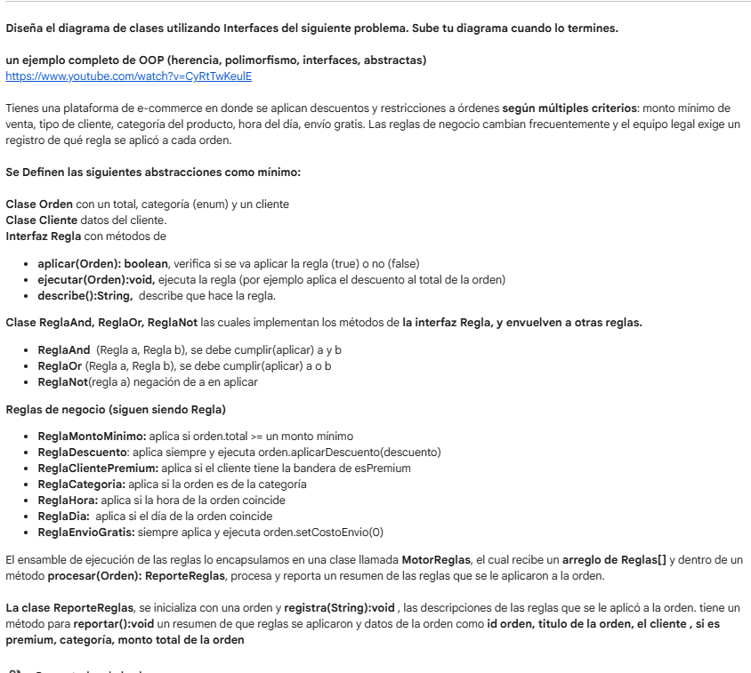

# Taller: Interfaces y polimorfismo (Reglas de negocio)

Diseña el diagrama de clases utilizando Interfaces del siguiente problema. Sube tu diagrama cuando lo termines.

un ejemplo completo de OOP (herencia, polimorfismo, interfaces, abstractas)
https://www.youtube.com/watch?v=CyRtTwKeulE

Tienes una plataforma de e-commerce en donde se aplican descuentos y restricciones a órdenes según múltiples criterios: monto mínimo de venta, tipo de cliente, categoría del producto, hora del día, envío gratis. Las reglas de negocio cambian frecuentemente y el equipo legal exige un registro de qué regla se aplicó a cada orden.

Se Definen las siguientes abstracciones como mínimo:

Clase Orden con un total, categoría (enum) y un cliente
Clase Cliente datos del cliente.
Interfaz Regla con métodos de

* aplicar(Orden): boolean, verifica si se va aplicar la regla (true) o no (false)
* ejecutar(Orden):void, ejecuta la regla (por ejemplo aplica el descuento al total de la orden)
* describe():String, describe que hace la regla.
Clase ReglaAnd, ReglaOr, ReglaNot las cuales implementan los métodos de la interfaz Regla, y envuelven a otras reglas.
ReglaAnd (Regla a, Regla b), se debe cumplir(aplicar) a y b
ReglaOr (Regla a, Regla b), se debe cumplir(aplicar) a o b
ReglaNot(regla a) negación de a en aplicar
Reglas de negocio (siguen siendo Regla)
ReglaMontoMinimo: aplica si orden.total >= un monto mínimo
ReglaDescuento: aplica siempre y ejecuta orden.aplicarDescuento(descuento)
ReglaClientePremium: aplica si el cliente tiene la bandera de esPremium
ReglaCategoria: aplica si la orden es de la categoría
ReglaHora: aplica si la hora de la orden coincide
ReglaDia: aplica si el día de la orden coincide
ReglaEnvioGratis: siempre aplica y ejecuta orden.setCostoEnvio(0)
El ensamble de ejecución de las reglas lo encapsulamos en una clase llamada MotorReglas, el cual recibe un arreglo de Reglas[] y dentro de un método procesar(Orden): ReporteReglas, procesa y reporta un resumen de las reglas que se le aplicaron a la orden.

La clase ReporteReglas, se inicializa con una orden y registra(String):void , las descripciones de las reglas que se le aplicó a la orden. tiene un método para reportar():void un resumen de que reglas se aplicaron y datos de la orden como id orden, titulo de la orden, el cliente , si es premium, categoría, monto total de la orden

